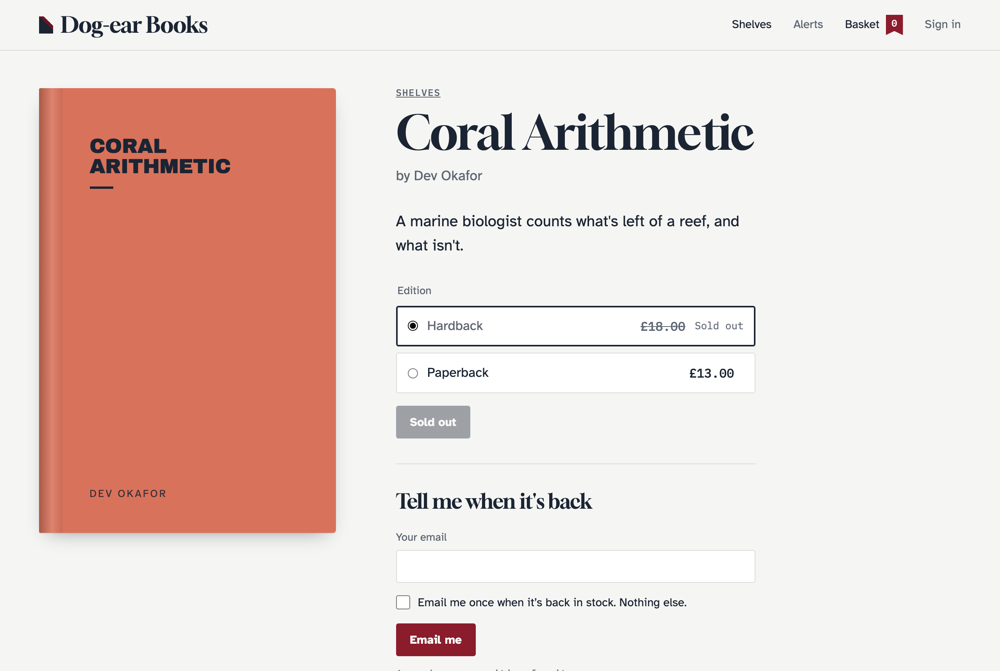
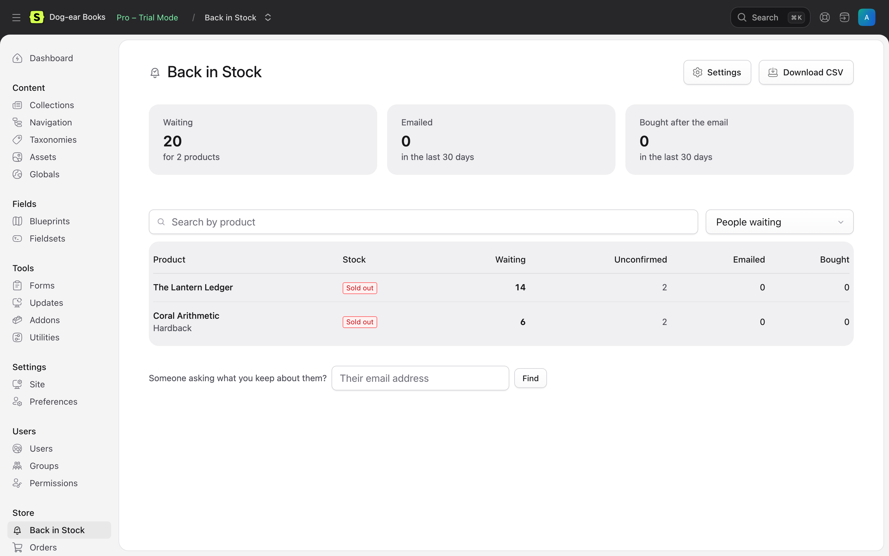
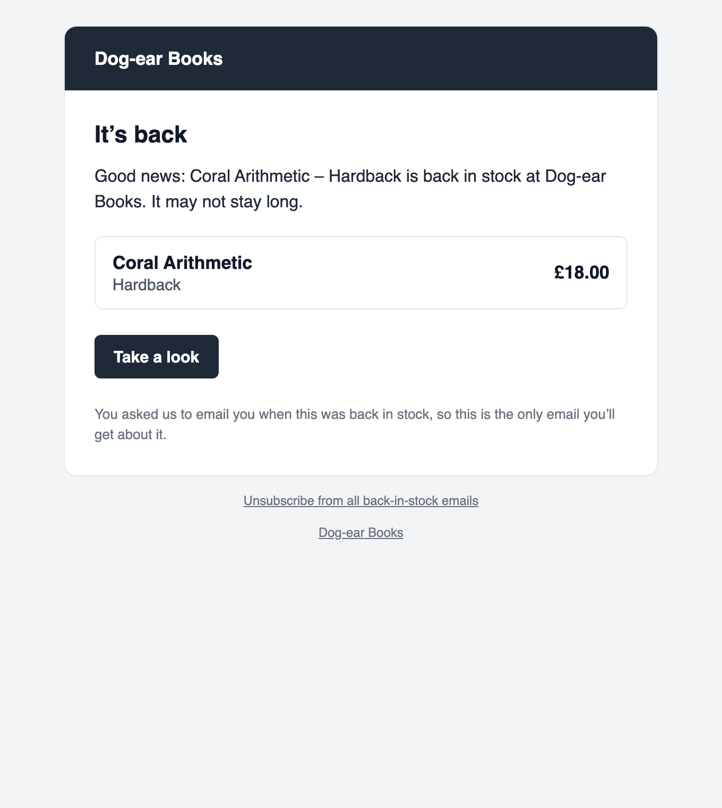

# Back in Stock for Statamic

"Tell me when it's back" for [Cargo](https://builtwithcargo.dev). Shoppers leave their email on a sold-out product, or a sold-out variant, and confirm it. When it's back in stock, they get one email. You see what people are waiting for, and who bought when it came back.

## Features

- **A form for sold-out products and variants.** One tag, your markup. It shows only while it's sold out, works without JavaScript and on statically cached pages, and can follow the size, colour or edition chosen on the page.
- **Confirmed by email.** Every request is confirmed with a button on the linked page, so nobody can sign someone else up, and mail apps' link checkers can't confirm for them. A consent tick box records the wording people agreed to.
- **Restocks noticed however they happen.** Stock changed in the Control Panel, put back by a cancelled order, written by an import: Back in Stock notices, and emails people, oldest request first.
- **Never twice, never too many.** Each request is emailed once. Email everyone, or as many people as units came back. A short wait lets you fix a mistyped stock level, and a per-minute limit keeps your mail provider happy.
- **One-click unsubscribe**, in the email and in the headers mail apps use.
- **Demand in the Control Panel.** Store → Back in Stock: the most wanted sold-out products, who's waiting, each restock, and how many bought after the email. A dashboard widget and CSV download.
- **Privacy.** Find, download or delete everything about an address. Old requests are deleted on a schedule. No IP addresses kept.
- **Multisite.** Emails go in the language of the site people asked on, with the right product link.
- **Spam protection.** A honeypot field, and limits per visitor and per address.
- **Yours to change.** Wording, logo and colours in the Control Panel. Publish the emails to change anything else. Events, a PHP API and a JSON API.

| The form | The Control Panel | The email |
| --- | --- | --- |
|  |  |  |

The screenshots are from Dog-ear Books, a made-up shop built only with the tags in [the docs](docs/README.md). **[Try the demo](https://github.com/1994limited/back-in-stock-statamic-demo)**: it runs locally in a few commands, with no licence needed. See [The demo shop](docs/demo.md).

## Requirements

- Statamic 6.35.1 or later, with Cargo 1.15 or later.
- PHP 8.3 or later, and a database (SQLite is fine).
- Laravel's scheduler running. A queue is recommended.
- Products with stock: a `stock` field on the blueprint, or a `stock` option field on Cargo's variants.

## Installation

```bash
composer require 1994/back-in-stock-statamic
php artisan migrate
```

Then add the form to your product template. It shows only while the product is sold out:

```antlers
{{ back_in_stock }}
    {{ if success }}
        <p>{{ success }}</p>
    {{ else }}
        <input type="email" name="email" value="{{ email }}" placeholder="Your email" required>
        <label><input type="checkbox" name="consent" value="1" required> {{ consent_text }}</label>
        <button>Email me when it's back</button>
    {{ /if }}
{{ /back_in_stock }}
```

<details>
<summary>Blade</summary>

```blade
<s:back_in_stock :product="$id">
    @if ($success)
        <p>{!! $success !!}</p>
    @else
        <input type="email" name="email" value="{!! $email !!}" placeholder="Your email" required>
        <label><input type="checkbox" name="consent" value="1" required> {!! $consent_text !!}</label>
        <button>Email me when it's back</button>
    @endif
</s:back_in_stock>
```

</details>

That's it: put the product back in stock, and everyone who confirmed is emailed. See [Templates](docs/templates.md) for variants, errors, a customer's alerts and static caching.

## Documentation

Everything else is in [the documentation](docs/README.md):

- [Installation](docs/installation.md) and [configuration](docs/configuration.md)
- [Templates](docs/templates.md), [tags](docs/tags.md) and [the demo shop](docs/demo.md)
- [Restocks](docs/restocks.md), [emails](docs/emails.md), [the Control Panel](docs/control-panel.md) and [privacy](docs/privacy.md)
- [Events](docs/events.md), [PHP API](docs/php-api.md), [HTTP API](docs/http-api.md) and [troubleshooting](docs/troubleshooting.md)

## Licence

Back in Stock is commercial software, sold through the [Statamic Marketplace](https://statamic.com/marketplace). Try it free on a local or development site. Each public site needs a licence. See [LICENSE.md](LICENSE.md).

## Support

Report bugs and ask questions through the addon's page on the Statamic Marketplace, or email [hello@1994.co.uk](mailto:hello@1994.co.uk).

## Development

```bash
composer install && npm install
vendor/bin/phpunit   # restocks, sending, the form, tags, emails, the Control Panel, and every example in the docs
npm run build        # the Control Panel pages
```
